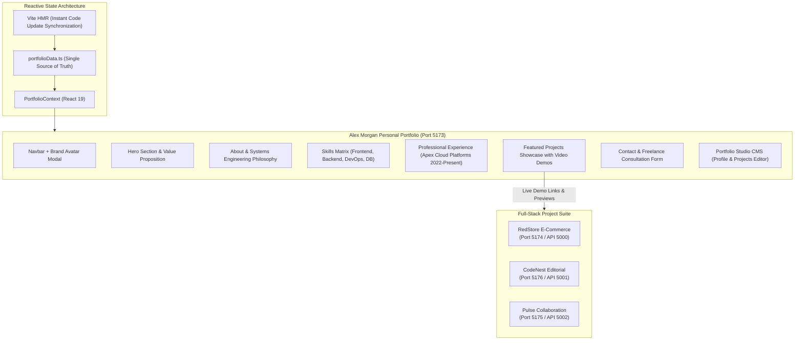

# 💼 Alex Morgan — Professional Full-Stack Engineering Portfolio

[](https://react.dev/)
[](https://www.typescriptlang.org/)
[](https://vitejs.dev/)
[](https://tailwindcss.com/)
[](https://opensource.org/licenses/MIT)

> **High-Performance Engineering Portfolio & Interactive Operations Studio**  
> Showcasing scalable web applications, real-time distributed systems, and technical support architecture.

---

## 🌟 Executive Summary

This repository houses the modern personal portfolio and interactive engineering showcase for **Alex Morgan** (Senior Full-Stack Engineer, Systems Architect, and Technical Support Engineer at Apex Cloud Platforms). 

Built with **React 19**, **TypeScript**, **Tailwind CSS**, and **Vite**, the application acts as an executive command center showcasing three production-grade engineering microservices:
1. **RedStore E-Commerce Platform** (Transactional commerce with zero-trust checkout & live KPI aggregation)
2. **CodeNest Tech Editorial Platform** (Markdown-driven developer journal with 6 topic hubs & CMS studio)
3. **Pulse Real-Time Collaboration Platform** (Sub-15ms WebSocket messaging, voice notes & multi-user presence)

The portfolio features full client-side state hydration, interactive project modals, video showcase players, responsive dark-mode elements, a WhatsApp-style avatar inspector modal, and an integrated **CMS Portfolio Studio** for real-time profile management.

---

## 📐 System Architecture



---

## 🚀 Key Features

### 👤 Profile & Brand Identity
- **Interactive Avatar Inspector:** Custom SVG vector avatar in the navigation bar with click-to-expand WhatsApp-style modal popup (with disabled context save menu to protect image assets).
- **Executive Philosophy:** Dual-discipline positioning combining full-stack development with mission-critical technical support engineering and system reliability.
- **Verified Credentials:** Master's in Computer Science, professional contact channels, and GitHub/LinkedIn integrations.

### 🛠️ Technical Competency Matrix
- **Core Languages & Web:** TypeScript, JavaScript (ES2024), HTML5, CSS3, SCSS, Python, SQL.
- **Frontend Architecture:** React 19, Next.js, Redux Toolkit, Tailwind CSS, Vite, WebSockets, HTML5 Canvas.
- **Backend & Distributed Systems:** Node.js, Express.js 5, Socket.IO, RESTful APIs, JWT Authentication, Microservices.
- **Databases & Caching:** MongoDB, Mongoose ODM, PostgreSQL, Redis (Cache-Aside, Sliding-Window Limiting).
- **DevOps, Cloud & Tooling:** Docker, Kubernetes, Nginx, CI/CD, Git, GitHub Actions, Postman, Linux.

### 💼 Professional Experience Showcase
- Highlights current tenure (**2022 – Present**) at **Apex Cloud Platforms** as **Technical Support Engineer & Systems Architect**:
  - Investigates and resolves complex L3 production bugs across distributed cloud systems.
  - Architects resilient fallbacks, database index optimizations, and caching policies reducing p99 latency by 35%.
  - Authors post-mortems and standard operating procedures (SOPs) preventing systemic defect recurrence.

### 🖥️ Deep-Dive Project Showcase
Each project card links directly to:
- **Live Interactive Demo:** One-click launch to the local running client.
- **CMS Admin Studio:** Direct access to the respective administration and KPI dashboard.
- **Source Code Repository:** Clean links to GitHub source code.
- **Embedded Demonstration Videos:** Instant access to 24 curated high-definition video walkthroughs and master feature reels.

### ⚙️ Portfolio Studio CMS
- Client-side administration hub allowing instant in-browser updates to profile details, biographical paragraphs, skills inventory, and projects.
- Decoupled from stale `localStorage` locks to guarantee instant Vite Hot Module Replacement (HMR) upon code updates.

---

## 🧰 Tech Stack & Dependencies

| Technology | Purpose | Version |
| :--- | :--- | :--- |
| **React** | Component-driven UI framework with concurrent rendering | `^19.0.0` |
| **TypeScript** | Strict compile-time type safety and interface modeling | `^5.8.2` |
| **Vite** | Lightning-fast development server with ESBuild HMR | `^6.2.0` |
| **Tailwind CSS** | Utility-first responsive design system and dark theme primitives | `^3.4.17` |
| **React Router DOM** | Client-side routing and declarative navigation | `^7.3.0` |
| **Lucide React** | Consistent, lightweight SVG icon system | `^1.16.0` |

---

## 📁 Project Directory Structure

```
personal-portfolio/
├── public/
│   ├── avatar.svg            # Custom SVG engineer profile avatar
│   └── favicon.ico           # Application favicon
├── src/
│   ├── assets/               # Static images and icons
│   ├── components/           # Reusable UI components
│   │   ├── AboutSection.tsx      # Biography and systems engineering philosophy
│   │   ├── AvatarModal.tsx       # WhatsApp-style image expander modal
│   │   ├── ContactSection.tsx    # Consultation and contact form
│   │   ├── ExperienceSection.tsx # Current Apex Cloud Platforms role (2022-Present)
│   │   ├── Footer.tsx            # Global site footer
│   │   ├── HeroSection.tsx       # Headline banner and CTA buttons
│   │   ├── Navbar.tsx            # Navigation header with avatar trigger
│   │   ├── ProjectCard.tsx       # Showcase card for featured apps
│   │   ├── ProjectDetailModal.tsx# Comprehensive project modal with video links
│   │   └── SkillsSection.tsx     # Categorized technical competencies
│   ├── context/
│   │   └── PortfolioContext.tsx  # Centralized application state and HMR bridge
│   ├── data/
│   │   └── portfolioData.ts      # Profile, projects, experience & skills data
│   ├── pages/
│   │   ├── HomePage.tsx          # Public single-page portfolio layout
│   │   └── admin/
│   │       ├── AdminDashboard.tsx# Portfolio Studio management dashboard
│   │       ├── AdminProjects.tsx # Project portfolio editor
│   │       └── AdminSkills.tsx   # Skill matrix editor
│   ├── types/
│   │   └── index.ts              # Global TypeScript interfaces and schemas
│   ├── App.tsx               # Root router and layout container
│   ├── main.tsx              # DOM mounting and entry point
│   └── index.css             # Tailwind base styles and font declarations
├── index.html                # HTML5 template
├── package.json              # Project metadata and dependencies
├── postcss.config.js         # PostCSS configuration
├── tailwind.config.js        # Tailwind theme tokens and extensions
├── tsconfig.json             # TypeScript compiler settings
└── vite.config.ts            # Vite bundler configuration
```

---

## 🚀 Getting Started

### 📋 Prerequisites
- **Node.js:** `v18.0.0` or higher (Recommended: `v20.x` or `v22.x`)
- **Package Manager:** `npm` (bundled with Node.js)

### 📥 1. Installation
Navigate to the project root and install dependencies:
```bash
cd personal-portfolio
npm install
```

### 💻 2. Launch Development Server
Start the local Vite development server:
```bash
npm run dev
```
The application will boot at:
👉 **`http://localhost:5173`**

### 📦 3. Production Build
Compile TypeScript and bundle optimized static assets for production:
```bash
npm run build
```
Preview the production build locally:
```bash
npm run preview
```

---

## 🔗 Integrated Ecosystem URLs

When running alongside the workspace microservices suite, the portfolio links directly into:

| Platform | Role | Frontend URL | Backend API |
| :--- | :--- | :--- | :--- |
| **Personal Portfolio** | Main Hub | `http://localhost:5173` | — |
| **RedStore E-Commerce** | Transactional Shop & Admin | `http://localhost:5174` | `http://localhost:5000` |
| **Pulse Collaboration** | Real-Time Messaging & Chat | `http://localhost:5175` | `http://localhost:5002` |
| **CodeNest Tech Blog** | Tech Editorial & Publishing | `http://localhost:5176` | `http://localhost:5001` |

---

## 📄 License

This project is licensed under the **MIT License** — feel free to use it as inspiration for your own engineering portfolio.

---

*Designed and engineered by **Alex Morgan** — Senior Full-Stack Engineer & Systems Architect.*
